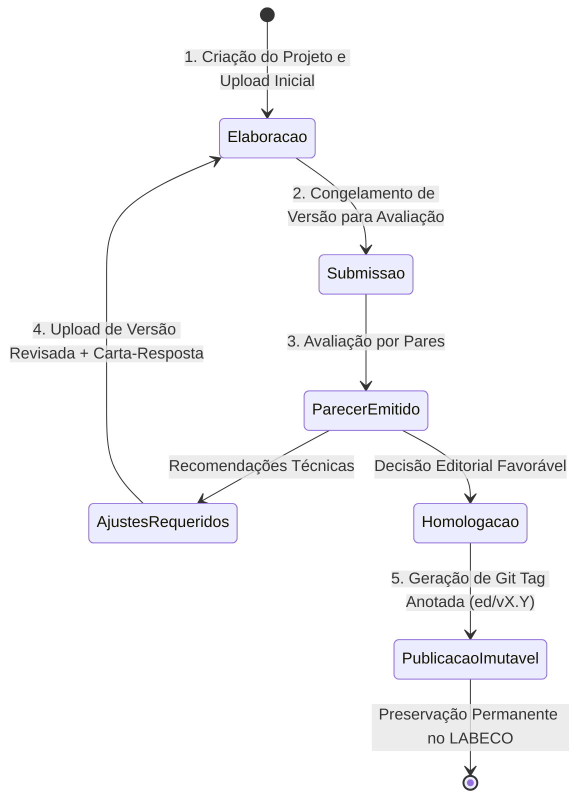

# Proposta de Governança Editorial e Proveniência Documental
## Ecossistema SisTer Git · LABECO / Embrapa

*Laboratório de Estudos em AgroEcologia e Recursos Naturais (LABECO)*  
*Outubro de 2026 · Versão 1.0 — Documento de Governança Institucional*

> *"Sempre pronto. Sempre incompleto!"*  
> *"Versionar um documento significa registrar o que mudou.  
> Gerir um processo editorial significa registrar como, por que, por quem e sob quais critérios o documento evoluiu."*

---

## 1. Sumário Executivo

A produção científica e técnica institucional — artigos, boletins de pesquisa, relatórios técnicos, livros e pareceres — constitui o patrimônio epistêmico mais valioso de uma unidade de pesquisa. Contudo, os fluxos tradicionais de redação e editoração sofrem de problemas crônicos:
1. **Dispersão e Perda de Versões**: Múltiplos arquivos nomeados como `artigo_final.docx`, `artigo_final_revisado_v2.docx`, trocados por e-mail ou pastas compartilhadas sem integridade verificável.
2. **Ausência de Proveniência Formal**: Dificuldade em comprovar quem fez qual alteração, qual parecer motivou cada corte ou inclusão e quando cada versão foi homologada.
3. **Dependência de Plataformas Proprietárias Fechadas**: Soluções em nuvem externas que não garantem custódia soberana de dados científicos sensíveis.

O **SisTer Git Editorial** propõe uma governança baseada em **Git bare com custódia soberana na infraestrutura do LABECO (`labeco-srv`)**, unindo o rigor criptográfico das árvores Merkle à realidade prática dos pesquisadores, acolhendo formatos como **Word (`.docx`)**, **LibreOffice (`.odt`)**, **LaTeX (`.tex`)**, **Markdown (`.md`)** e **Quarto (`.qmd`)**.

---

## 2. Princípio da Realidade Operacional: Acomodação de Formatos

Um sistema editorial não pode exigir que cientistas escrevam teses ou relatórios complexos em caixas de texto de navegadores web. O SisTer Git adota como premissa:

1. **Ferramenta Nativa do Pesquisador**:
   - Pesquisadores que trabalham em processadores visuais utilizam **Microsoft Word (`.docx`)** ou **LibreOffice Writer (`.odt`)**.
   - Pesquisadores de modelagem e matemática utilizam **LaTeX (`.tex`)** ou **Quarto (`.qmd`)**.
   - Redatores técnicos e desenvolvedores utilizam **Markdown (`.md`)** ou texto estruturado.
2. **O Git como Custódia e Rastreabilidade Soberana**:
   - O pesquisador edita em seu computador e envia as versões para o SisTer Git (via interface web de upload ou comando `git push`).
   - O SisTer Git armazena o artefato original, extrai o carimbo de tempo, associa o autor institucional autenticado (`@embrapa.br`) e gera um commit atômico imutável.
   - Qualquer colaborador ou parecerista pode baixar a versão exata de qualquer momento histórico (`raw download`), garantindo rastreabilidade total.

---

## 3. Matriz de Papéis e Permissões

| Papel | Identificação | Responsabilidades e Permissões |
| :--- | :--- | :--- |
| **Autor Principal** | Pesquisador Responsável | Criação do repositório, upload de versões de manuscrito, definição de coautores e resposta formal aos pareceres. |
| **Coautores / Colaboradores** | Pesquisadores Autorizados | Leitura de projetos privados vinculados, download dos artefatos e sugestão de contribuições. |
| **Parecerista / Revisor por Pares** | Pesquisador / Convidado | Acesso à versão submetida, emissão de parecer formal fundamentado (Aprovado, Revisões Requeridas, Rejeitado). |
| **Editor / Comitê Editorial** | Administrador do SisTer Git | Homologação de decisões, emissão de tags anotadas de publicação imutável (`ed/vX.Y`), gestão da lista de pesquisadores autorizados. |
| **Público / Comunidade** | Acesso Anônimo (LAN) | Acesso de leitura e download apenas aos documentos explicitamente classificados como `Público`. |

---

## 4. O Ciclo de Vida Documental em 5 Estágios



### Estágio 1: Elaboração e Rascunho Ativo (`draft`)
- O projeto é criado com visibilidade **Privada** (somente autor e comitê) ou **Pública**.
- O autor faz o upload de seus arquivos de trabalho (`.docx`, `.odt`, `.tex`, figuras, tabelas).
- Cada salvamento gera um commit no Git com mensagem descritiva (ex.: *"Capítulo 2: Metodologia e Delineamento Amostral"*).

### Estágio 2: Submissão Formal (`submitted` / `in_review`)
- Ao concluir a redação, o autor fecha a rodada e submete o manuscrito.
- Uma tag de submissão pode ser gerada (ex.: `ed/v1.0-submissao`), congelando o estado exato do texto para os avaliadores.

### Estágio 3: Avaliação por Pares e Pareceres (`review`)
- Pareceristas designados baixam o documento no formato original (`.docx`, `.odt`, `.pdf` gerado).
- O parecer é registrado formalmente no SisTer Git contendo:
  - Identificação do parecerista e filiação institucional.
  - Recomendação: **Aceito sem alterações**, **Aceito com revisões requeridas**, **Revisar e ressubmeter**, ou **Rejeitar**.
  - Fundamentação técnica e apontamentos metodológicos.
- O parecer é criptograficamente incorporado ao manifesto `.sister-editorial.json`.

### Estágio 4: Incorporação de Melhorias e Resposta (`revision`)
- O autor recebe os pareceres pela plataforma.
- Edita o manuscrito em seu software local atendendo às recomendações.
- Realiza o upload da nova versão do arquivo acompanhado da **Carta de Resposta aos Pareceres**.

### Estágio 5: Homologação e Publicação Imutável (`published`)
- O editor científico valida o atendimento de todos os pontos.
- É disparada a publicação da edição:
  - Criação de tag Git anotada e assinada: `ed/v1.0`, `ed/v2.0`.
  - Mudança automática do estágio documental para `✓ Publicado`.
  - Preservação da árvore Merkle para fins de citação científica, proveniência e auditoria.

---

## 5. Estrutura do Manifesto Editorial Soberano (`.sister-editorial.json`)

Para que a proveniência não dependa de bancos de dados externos e viaje junto com o próprio repositório Git bare:

```json
{
  "$schema": "https://sister-git.labeco.org/schemas/editorial-v1.json",
  "project_type": "editorial",
  "title": "Dinâmica Temporal e Conservação dos Campos Nativos no Bioma Pampa",
  "document_main": "manuscrito_completo.docx",
  "formats": ["docx", "pdf", "odt"],
  "authors": [
    { "name": "José Pedro Trindade", "role": "Autor Principal", "affiliation": "Embrapa / LABECO" }
  ],
  "current_stage": "in_review",
  "reviews": [
    {
      "id": "REV-2026-001",
      "commit": "d1b2895...",
      "reviewer": "Dra. Avaliadora 1",
      "date": "2026-10-21T16:00:00-03:00",
      "recommendation": "accept_with_revisions",
      "summary": "Excelente contextualização. Recomendo acrescentar análise sobre o estrato arbustivo.",
      "resolution": {
        "resolved_in_commit": "e4f812a...",
        "author_response": "Adicionado parágrafo e tabela complementar no tópico 3.2."
      }
    }
  ],
  "editions": [
    {
      "tag": "ed/v1.0-submissao",
      "title": "Versão Inicial Submetida para Avaliação",
      "date": "2026-10-21T11:16:51-03:00"
    }
  ]
}
```

---

## 6. Soberania e Resiliência na Infraestrutura do LABECO

1. **Repositórios Bare Centrais**: Armazenados em `/srv/git/` no servidor institucional `labeco-srv` (IP `10.163.80.129`).
2. **Daemon Autônomo de Produção (`systemd`)**: O serviço `sister-git-web.service` opera como daemon independente de sessões de usuário, com reinicialização automática (`Restart=always`), escutando em `http://10.163.80.129:8787` e protegido por arquivo restrito de variáveis (`/etc/sister-git-web.env`, `0600`).
3. **Sincronização Bidirecional & Alta Disponibilidade (HA)**: Replicação criptográfica contínua entre o servidor central e os nós clientes autorizados, prevenindo perdas mesmo em falhas de hardware.
4. **Autenticação Passwordless Institucional**: Validação de pesquisadores via código de uso único (OTP) enviado exclusivamente para e-mails institucionais `@embrapa.br`, com controle de acesso em lista restrita gerenciada pelo administrador.
5. **Exportação e Download**: O pesquisador pode a qualquer momento baixar o repositório completo via Git Clone (`SSH`), ou baixar um arquivo `.zip`/`.tar.gz` completo, ou baixar arquivos individuais (`.docx`, `.odt`, `.tex`) com um único clique.

---

*Laboratório de Estudos em AgroEcologia e Recursos Naturais (LABECO)*  
*Embrapa Pecuária Sul · SisTer Git Editorial*

