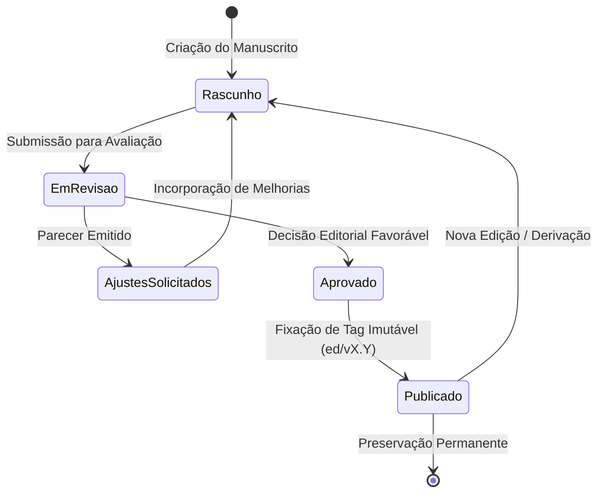

# SisTer Git Editorial (SGE)

**Gestão editorial, proveniência e evolução documental baseada em Git**  
*Laboratório de Estudos em AgroEcologia e Recursos Naturais (LABECO) · Outubro de 2026*

> *"Versionar um documento significa registrar o que mudou.*  
> *Gerir um processo editorial significa registrar como, por que, por quem e sob quais critérios o documento evoluiu."*

---

## 1. Visão e Motivação

O **SisTer Git Editorial** estende o núcleo seguro do SisTer Git para a produção, revisão, aprovação e preservação de documentos científicos, relatórios técnicos, livros e protocolos de pesquisa.

Diferente de sistemas de edição colaborativa síncrona (como Google Docs ou Word) ou de versionamento de software puro:
1. **O Git é a base de integridade:** Toda versão é uma árvore de Merkle imutável com hash criptográfico.
2. **Decisões são registradas:** Não basta saber que uma frase mudou; é essencial registrar o parecer que motivou a mudança, a justificativa apresentada pelo autor e a decisão do editor.
3. **Alinhamento com Proveniência (W3C PROV):** Relaciona **Entidades** (versões de documentos, dados, figuras), **Atividades** (submissão, parecer, revisão, aprovação) e **Agentes** (autores, revisores, editores).
4. **Independência de formatos:** Acolhe Markdown, Quarto (`.qmd`), LaTeX (`.tex`), documentos estruturados e relatórios.

---

## 2. Ciclo de Vida Editorial



| Estágio | Identificador | Significado |
| :--- | :--- | :--- |
| **Elaboração** | `draft` | Manuscrito em redação pelos autores. Versões de trabalho. |
| **Em Revisão** | `review` | Versão congelada submetida a pareceristas e colaboradores. |
| **Ajustes** | `revision` | Atendimento das recomendações e registro de respostas. |
| **Aprovado** | `approved` | Decisão formal do editor vinculada a um commit específico. |
| **Publicado** | `published` | Versão final fixada por tag editorial imutável (ex.: `ed/v1.0`). |

---

## 3. Estrutura do Manifesto de Proveniência (`.sister-editorial.json`)

Para que o processo editorial seja imutável e viaje junto com o repositório, cada projeto editorial mantém um manifesto na raiz de sua branch principal:

```json
{
  "$schema": "https://sister-git.labeco.org/schemas/editorial-v1.json",
  "project_type": "editorial",
  "title": "Dinâmica dos Campos Nativos no Bioma Pampa",
  "document_main": "manuscrito.md",
  "abstract": "Estudo sobre a evolução temporal e conservação da vegetação campestre nativa.",
  "authors": [
    { "name": "José Pedro Trindade", "role": "Autor Principal", "affiliation": "Embrapa / LABECO" }
  ],
  "current_stage": "in_review",
  "reviews": [
    {
      "id": "REV-001",
      "commit": "edbd8733abad84a0c584a56a074fd4a9f4cb1b6c",
      "reviewer": "Revisor Convidado 1",
      "date": "2026-10-21T10:00:00-03:00",
      "recommendation": "adjustments",
      "summary": "Recomenda detalhar o método de amostragem no tópico 2 e justificar a exclusão de áreas degradadas.",
      "resolution": {
        "resolved_in_commit": "c3b2764123...",
        "author_response": "Adicionado parágrafo detalhando o delineamento amostral com base em Trindade et al. (2024)."
      }
    }
  ],
  "decisions": [
    {
      "decision_type": "acceptance",
      "editor": "Editor Científico",
      "date": "2026-10-21T11:00:00-03:00",
      "target_commit": "c3b2764123...",
      "notes": "Todas as recomendações do parecer REV-001 foram devidamente sanadas no texto."
    }
  ],
  "editions": [
    {
      "tag": "ed/v1.0",
      "commit": "c3b2764123...",
      "title": "Primeira Edição — Versão Submetida ao Comitê",
      "date": "2026-10-21T12:00:00-03:00"
    }
  ]
}
```

---

## 4. Configuração do Repositório Git

Para identificar um repositório como editorial no SisTer Git:

```bash
# Definir o repositório como editorial no servidor
git --git-dir=/srv/git/PROJETO.git config sister.type editorial

# Ou manter como repositório de software (padrão)
git --git-dir=/srv/git/SOFTWARE.git config sister.type software
```

---

## 5. Integração com o SisTer Git Web & Identidade MORFO

1. **Identidade Visual MORFO**: Sidebar profunda (`#071e38` a `#0c2844`), acentos em azul celeste (`#2ea8e8`) e verde-azulado (`#087f8c`), tipografia moderna (*Plus Jakarta Sans*, *Inter*, *JetBrains Mono*).
2. **Espaço de Trabalho Dual**:
   - **Espaço Editorial**: Dashboard dedicado, cards de artigos com badges de estágio (`draft`, `in_review`, `published`), leitor acadêmico, editor split com preview em tempo real e timeline de pareceres.
   - **Espaço Repositórios**: Gestão de código-fonte, navegação na árvore de arquivos, histórico de commits, tags/branches e visualizador de diffs estilo GitHub.
3. **Plumbing Git no Backend C++26**: Operações de escrita atômica em repositórios bare sem necessidade de working tree (usando `hash-object`, temporary `GIT_INDEX_FILE`, `write-tree`, `commit-tree` e `update-ref`).
4. **Sem comandos Git no navegador**: O usuário realiza todo o ciclo editorial (escrever, salvar versões, emitir pareceres e publicar) pela interface web.

---

## 6. Endpoints Interativos da API C++26

| Método | Rota | Descrição |
| :--- | :--- | :--- |
| `POST` | `/api/v1/repos` | Inicializa repositório bare com manifesto e manuscrito modelo |
| `POST` | `/api/v1/repos/{name}/editorial/save` | Salva nova versão de manuscrito criando commit no Git |
| `POST` | `/api/v1/repos/{name}/editorial/review` | Registra parecer editorial em `.sister-editorial.json` |
| `POST` | `/api/v1/repos/{name}/editorial/publish` | Cria tag anotada imutável `ed/*` e avança estágio para `published` |
| `GET` | `/api/v1/repos/{name}/editorial` | Retorna metadados editoriais, manifesto, pareceres e tags |

---

*Sempre pronto. Sempre incompleto!*
